# DJScope

**Painel de análise de áudio ao vivo para DJs, no Linux** — waveform de CDJ em 3 bandas, espectro, spectrograma,
stereo por banda, loudness (LUFS), true peak, **BPM, tonalidade em Camelot, contagem de compasso/frase** e registro
automático do set. Capta o que o sistema está tocando (PipeWire/PulseAudio).

> *English TL;DR — DJScope is a real-time audio analysis dashboard for DJs on Linux (Qt/PySide6): CDJ-style 3-band
> scrolling waveform, spectrum (curve / LED bars / 3D waterfall / key wheel), spectrogram, per-band goniometer and
> stereo-field map, LUFS, true peak, BPM, Camelot key, bar/phrase counter, bass-mono check and an automatic
> tracklist (MPRIS) exported to CSV. It listens to your system output. Docs below are in Portuguese.*

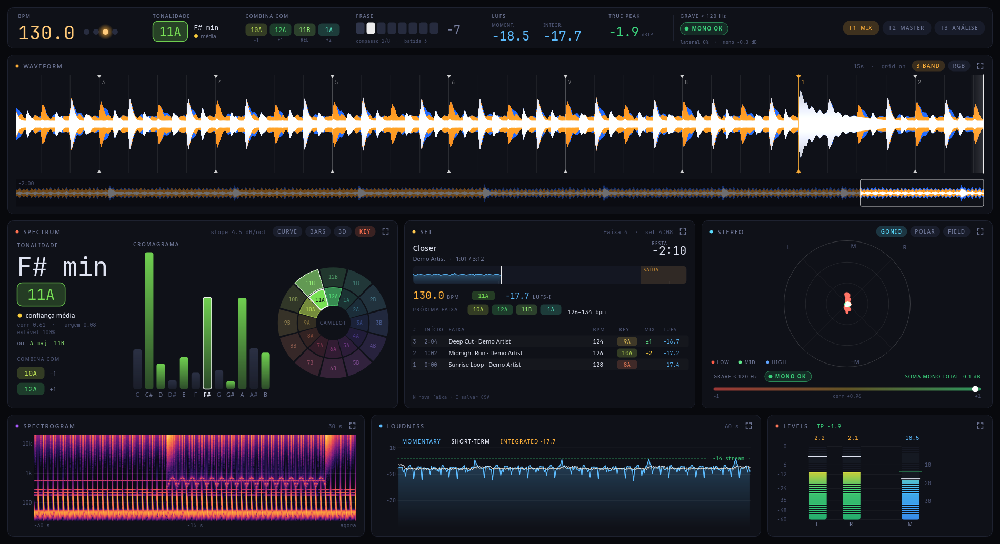

Começou como um painel de terminal inspirado no [MiniMeters](https://minimeters.app/) (Windows) e nos skins de áudio do
Rainmeter — e virou um app Qt de verdade quando ficou claro que uma grade de caracteres não chega à mesma qualidade
visual. A versão de terminal continua no repositório (`djscope-tui`).

*Projeto independente, sem afiliação com MiniMeters, Rainmeter, Pioneer DJ ou Mixed In Key.*

---

## O que ele mostra

| Painel | O que tem |
|---|---|
| **Barra de decisão** (fixa no topo) | O que decide a mixagem, sempre à vista, inclusive no modo foco: **BPM** com LEDs de compasso, **tonalidade em Camelot** (com confiança e as 4 compatíveis: −1, +1, relativa, +2), **frase** (8 compassos + contagem regressiva), **LUFS** momentâneo e integrado, **true peak** com contador de clips e o selo de **mono do grave**. Também troca os presets. |
| **Waveform** | Rolagem em 3 bandas (graves azul · médios âmbar · agudos branco; ou tema RGB), beatgrid, **compassos numerados, início de frase em âmbar**, overview dos últimos 30 s–2 min com a janela atual marcada. |
| **Spectrum** | 4 modos: **CURVE** (curva suave com pico retido), **BARS** (LED em 1/6 de oitava), **3D** (waterfall em perspectiva) e **KEY** (cromagrama + roda Camelot + "combina com"). Passe o mouse para ver **frequência, nota musical e dB**. |
| **Stereo** | 3 modos: **GONIO** (goniômetro colorido por banda + mini goniômetro, largura, correlação e histórico de 20 s para grave/médio/agudo), **POLAR** (nível polar por banda), **FIELD** (mapa panorama × frequência). Faixa inferior com **checagem de mono do grave (<120 Hz)** e perda ao somar em mono. |
| **Spectrogram** | 30 s de histórico em escala de cores. |
| **Loudness** | Momentary / short-term / integrated (ITU-R BS.1770, com K-weighting e gating), histórico de 60 s e referência de −14 LUFS. |
| **Levels** | Picos L/R com retenção, LUFS-M, **true peak** (sobreamostragem 4×) e contador de clips no título. |
| **Set** | **Faixa atual** (título/artista via MPRIS) com **linha do tempo** (curva de loudness desde o início, playhead e a *zona de saída* dos últimos 32 s), **tempo restante** (fica âmbar a 60 s e vermelho a 20 s), BPM/key/LUFS-I; bloco **próxima faixa** (as 4 tonalidades compatíveis e a janela de BPM de ±3 %/±6 % de pitch); e o histórico do set com a **relação harmônica com a faixa anterior** (`=`, `±1`, `rel`, `±2`, `✗`). Salva um CSV automaticamente. |

### Barra de decisão e presets

A faixa no topo reúne o que importa na hora de escolher e entrar com a próxima música. Ao lado dela, **três presets**
(`F1`/`F2`/`F3` ou clique nas pílulas) reorganizam os cards por tarefa — cada um já abre os modos certos:

| Preset | Para quê | Composição |
|---|---|---|
| **F1 · MIX** | escolher e entrar com a próxima faixa | waveform alta · espectro em **KEY** (roda Camelot) · **SET** · stereo · spectrogram · loudness · levels |
| **F2 · MASTER** | checar o som da saída | waveform · espectro em **CURVE** + stereo (gonio por banda) · loudness · levels · spectrogram |
| **F3 · ANÁLISE** | olhar a música por dentro | waveform em faixa fina · espectro **3D** + **campo estéreo** · spectrogram · loudness · levels |

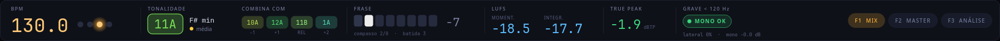

<table>
<tr>
<td>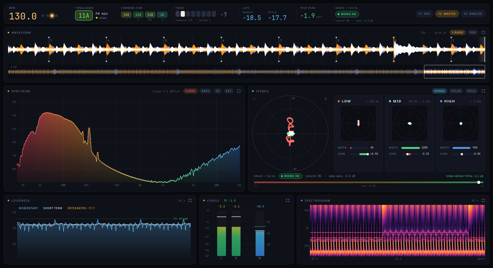</td>
<td>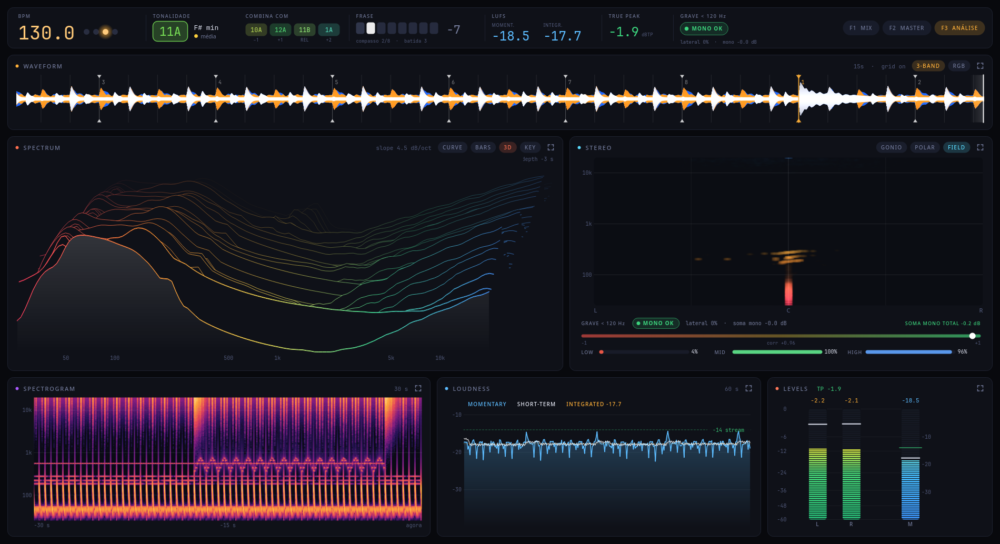</td>
</tr>
<tr>
<td align="center"><sub>F2 · MASTER</sub></td>
<td align="center"><sub>F3 · ANÁLISE</sub></td>
</tr>
</table>

### Modo foco

Dê **duplo clique** em qualquer card (ou use as teclas **1–7**) para torná-lo a visão principal, mantendo os outros
em miniaturas — **na lateral** ou **numa tira embaixo** (tecla **L**). Clique numa miniatura para trocar o foco.
No foco aparecem todos os cards, inclusive os que o preset oculta. O app lembra o preset, o foco, os modos e o
tamanho da janela.

<table>
<tr>
<td>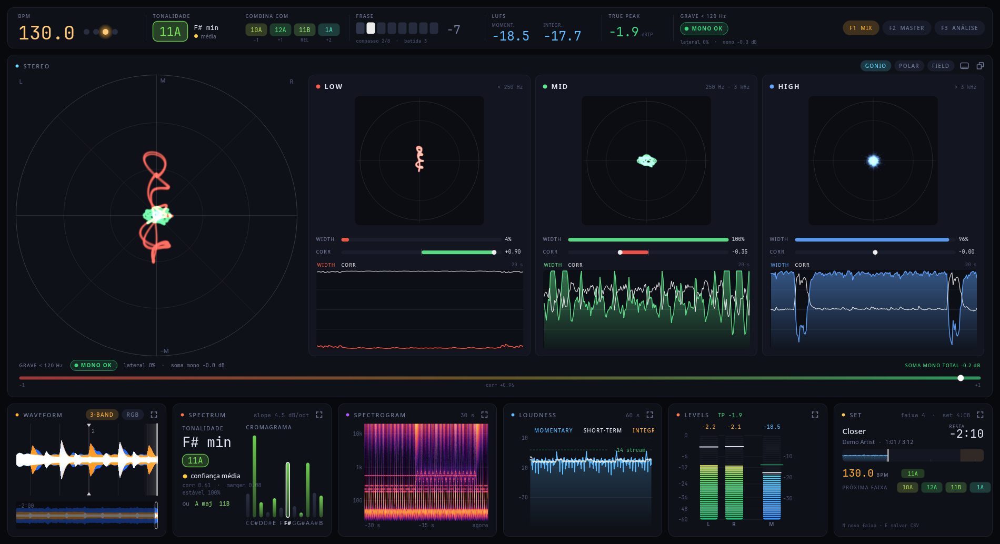</td>
<td>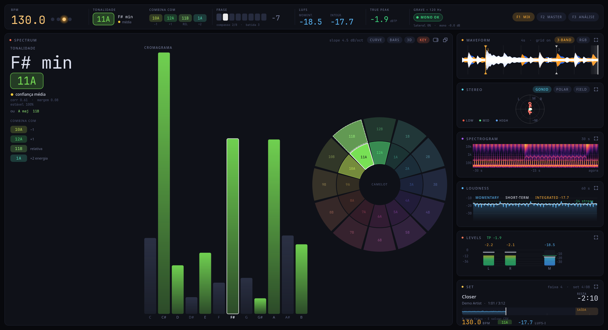</td>
</tr>
<tr>
<td align="center"><sub>Stereo por banda (miniaturas embaixo)</sub></td>
<td align="center"><sub>Tonalidade + roda Camelot (miniaturas na lateral)</sub></td>
</tr>
<tr>
<td>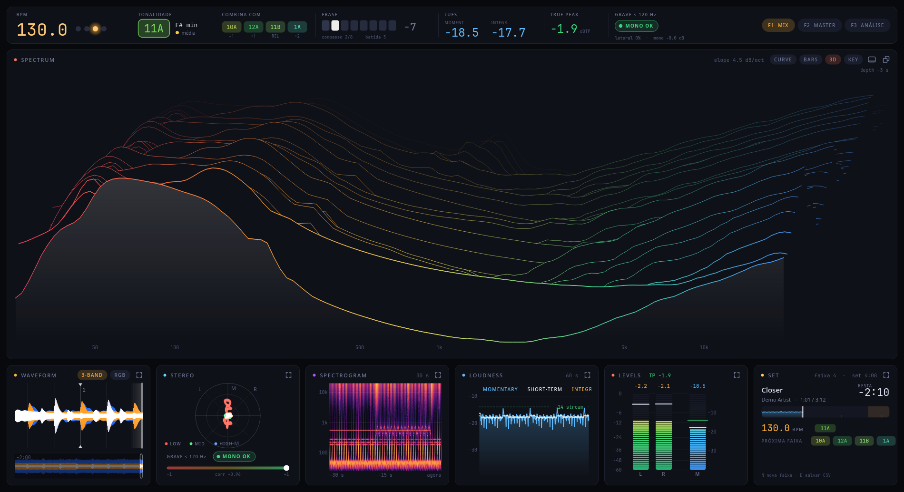</td>
<td>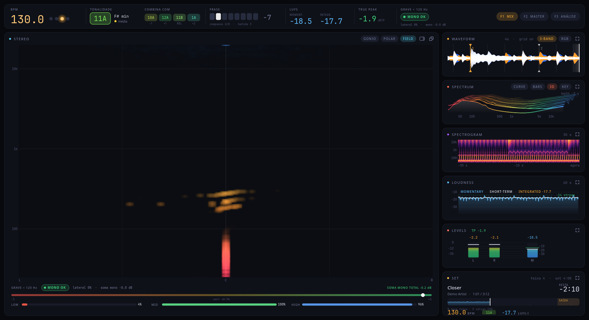</td>
</tr>
<tr>
<td align="center"><sub>Espectro em 3D</sub></td>
<td align="center"><sub>Campo estéreo (panorama × frequência)</sub></td>
</tr>
</table>

### Galeria dos cards

<table>
<tr>
<td></td>
<td>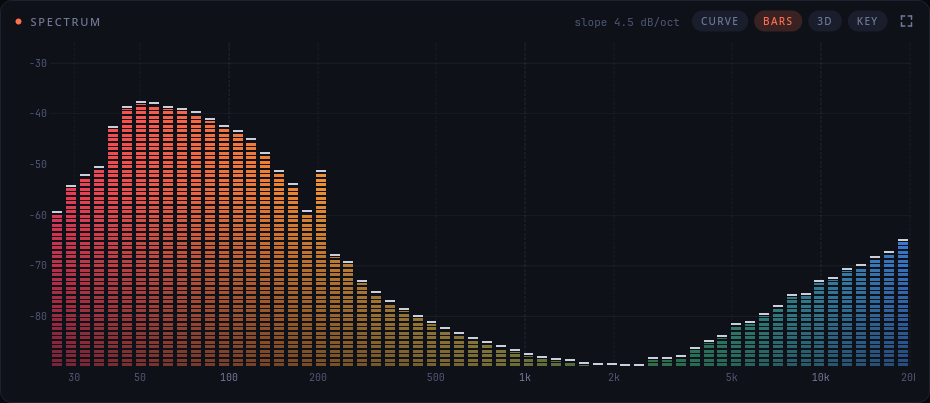</td>
</tr>
<tr>
<td>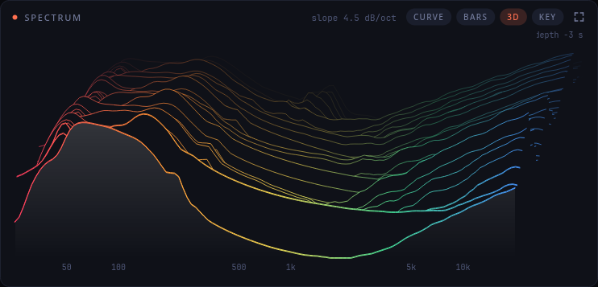</td>
<td>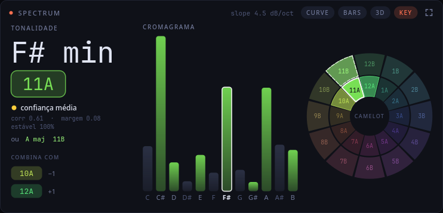</td>
</tr>
<tr>
<td>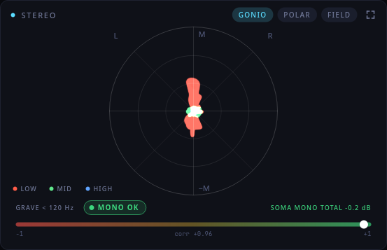</td>
<td>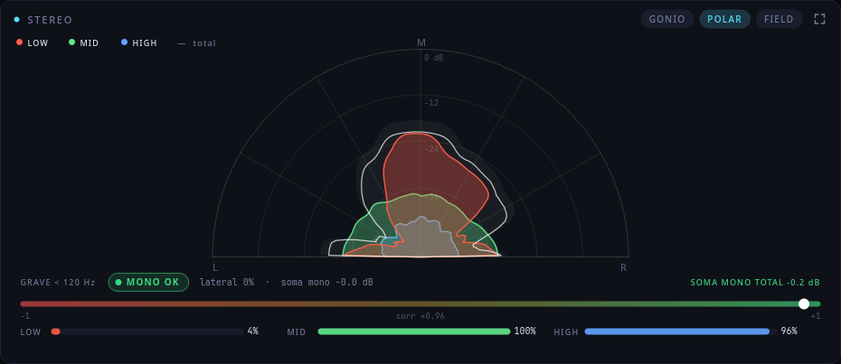</td>
</tr>
<tr>
<td>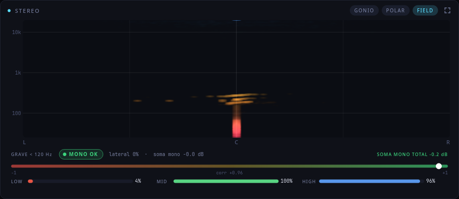</td>
<td>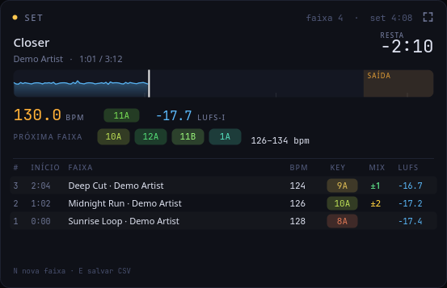 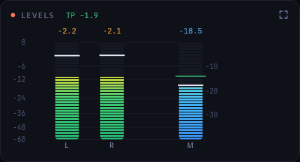</td>
</tr>
</table>

> Todos os prints usam **áudio sintético** gerado pelo próprio projeto (`dev/make_screenshots.py`), nada de áudio real.

---

## Requisitos

- **Linux** com **PipeWire ou PulseAudio** — o áudio vem do monitor da saída padrão via `parec`/`pactl`.
  (Windows e macOS não são suportados: a captura depende dessas ferramentas.)
- **Python 3.10+** (esperado; testado só no 3.14) · `numpy`, `scipy`, `PySide6-Essentials` (veja `requirements.txt`).
- *Opcional:* `busctl` (systemd) para ler o título da faixa via MPRIS (Spotify e outros players que o suportem);
  as fontes *Noto Sans* e *JetBrains Mono* (sem elas o Qt usa as padrão).

Testado em Arch Linux (Hyprland, Wayland) com Python 3.14, numpy 2.5, scipy 1.18 e PySide6 6.12.

## Instalação

```bash
git clone https://github.com/<seu-usuario>/djscope.git
cd djscope
./install.sh          # cria .venv, instala as dependências e os comandos `djscope` e `djscope-tui`
```

Sem instalar, direto da pasta:

```bash
python3 -m venv .venv && .venv/bin/pip install -r requirements.txt
.venv/bin/python djscope_gui.py --demo
```

## Uso

```bash
djscope                      # capta o áudio que está saindo no sistema
djscope --demo               # música sintética (128 BPM, Lá menor) para testar sem tocar nada
djscope --source <nome>      # usa outra fonte do pactl (veja `djscope-tui --list`)
```

### Atalhos

| Tecla | Ação | | Tecla | Ação |
|---|---|---|---|---|
| `1`–`7` | foca o card (waveform, espectro, stereo, spectrogram, loudness, levels, set) | | `S` | próximo modo do stereo |
| `0` / `Esc` | sai do foco | | `D` | próximo modo do espectro |
| `Tab` | percorre os cards em foco | | `G` | liga/desliga o beatgrid |
| `L` | miniaturas na lateral ↔ embaixo | | `C` | tema da waveform (3-band / RGB) |
| `F1` `F2` `F3` | presets MIX · MASTER · ANÁLISE | | | |
| `+` / `-` | zoom da waveform | | `Espaço` | pausa a imagem |
| `R` | zera LUFS integrado e picos | | `H` | mostra/oculta a barra de decisão |
| `N` | marca **nova faixa** manualmente | | `E` | salva o CSV do set agora |
| `F` / `F11` | tela cheia | | `Q` | sair |

Mouse: duplo clique num card = foco · clique numa miniatura = troca o foco · botões no título = modos · passe o mouse
sobre o espectro (CURVE/BARS) para ler frequência, nota e nível.

### Onde ficam os arquivos

| O quê | Onde |
|---|---|
| Sets (CSV) | `~/.local/share/djscope/sets/set-AAAAMMDD-HHMM.csv` |
| Estado (layout, modos, janela) | `~/.config/djscope/state.json` |

Colunas do CSV: `n, inicio, offset_s, duracao_s, artista, titulo, bpm, tonalidade, camelot, confianca_key, lufs_i, true_peak_dbtp, clips, motivo`.
O `motivo` diz como a troca de faixa foi detectada: `início`, `título` (MPRIS), `silêncio`, `BPM` (salto sustentado) ou `manual`.

---

## Como funciona

```
djscope.py        motor de análise (Engine, KeyDetector, PhraseTracker, TrackLog, NowPlaying) + versão de terminal
djscope_gui.py    interface Qt (cards, modo foco, StereoAnalyzer)
dev/              make_screenshots.py (prints do README), topng.py (terminal → PNG)
tests/            check_engine.py (motor, com áudio sintético de verdade conhecida) · check_ui.py (presets, foco, atalhos, persistência)
```

- **Captura:** `parec` (float32, 48 kHz, estéreo) lido numa thread; tudo é processado em blocos de 1600 amostras (33 ms).
- **Loudness:** K-weighting + janelas de 400 ms/3 s + gating relativo (BS.1770). **True peak:** sobreamostragem 4× por bloco.
- **BPM:** envelope de ataques → autocorrelação com *comb* de harmônicos → refinamento por casamento de pulsos (±8 %).
  O envelope do grave usa potência em janela de ~25 ms: a média de |x| ondula com baixos sustentados e cria ataques falsos.
- **Tonalidade:** picos espectrais (interpolação parabólica) → cromagrama acumulado (~33 s) → correlação com os perfis de
  Temperley (24 tonalidades) → código Camelot, com histerese e confiança que considera a estabilidade da decisão.
- **Compasso e frase:** conta as batidas da grade e estima o "1" do compasso e o início da frase de 8 compassos pela
  *novidade espectral* entre batidas/compassos. É uma heurística.
- **Stereo:** goniômetro por banda (filtros de 250 Hz / 3 kHz), campo panorama×frequência por FFT com zero-padding,
  largura = energia lateral / (meio + lado), checagem de mono do grave em <120 Hz.

## Precisão e limitações (leia antes de confiar)

Os números abaixo vêm de `tests/check_engine.py` — áudio **sintético** com resposta conhecida. Em música real, o que
foi feito é checagem de plausibilidade (as faixas de teste não têm "gabarito").

- **BPM:** exato em andamentos de 100–140 BPM nos testes sintéticos. Em música com ritmo marcado (house ~125) ficou estável
  (desvio < 0,5 BPM). Em faixas **sem kick marcado** (ambient) o BPM é pouco confiável — a interface o mostra apagado, com `~`.
  Em 150–174 BPM pode errar a razão (ex.: 2/3 do valor); o "meio-tempo" é aceito.
- **Tonalidade:** é difícil mesmo para ferramentas comerciais. Costuma confundir **tons vizinhos** e **maior × menor**, e leva
  ~30 s para estabilizar. O badge ganha `?` e aparece um candidato alternativo quando a confiança é baixa. Música eletrônica com
  pouca harmonia tende a ser pior.
- **Compasso e frase:** validados só com um arranjo sintético limpo (acerto de 100 % nos testes). Em música real é uma
  estimativa — confira com faixas que você conhece. A contagem de frase só aparece depois de ~30 s.
- **Troca de faixa automática:** por título (MPRIS), silêncio ou salto de BPM. Software de DJ que não expõe MPRIS só dispara por
  silêncio/BPM ou pela tecla `N`.
- **O que é analisado é a saída mestre.** Não há análise por deck.

## Desenvolvimento

```bash
.venv/bin/python tests/check_engine.py        # motor: tonalidade, BPM, compasso/frase, true peak, mono do grave, tracklist (~1–2 min)
.venv/bin/python tests/check_ui.py            # interface: presets, barra de decisão, modo foco, atalhos, persistência (~1 min)
.venv/bin/python dev/make_screenshots.py      # regenera docs/screenshots/ (offscreen, áudio sintético)
.venv/bin/python djscope_gui.py --shot out.png --secs 90 --size 1900x1034 --focus 2   # um print avulso
```

## Ideias futuras

- Entrada por deck (captar duas fontes e comparar BPM/key/espectro entre elas).
- Curva de energia da faixa (estilo Mixed In Key) no overview.
- Comparação com a faixa anterior (espectro "fantasma" para casar graves e brilho na transição).
- Cards como janelas flutuantes, sem moldura e transparentes (estilo widget de Rainmeter).
- Presets editáveis pelo usuário (hoje são três fixos).

## Licença

[MIT](LICENSE) © 2026 Sérgio Alexandre
